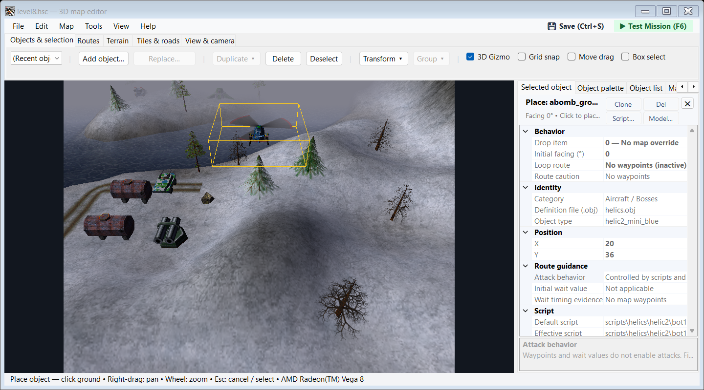
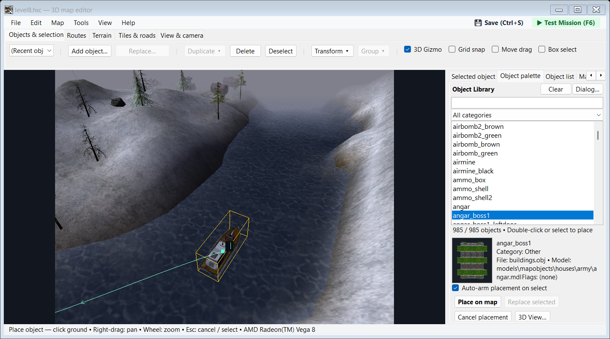
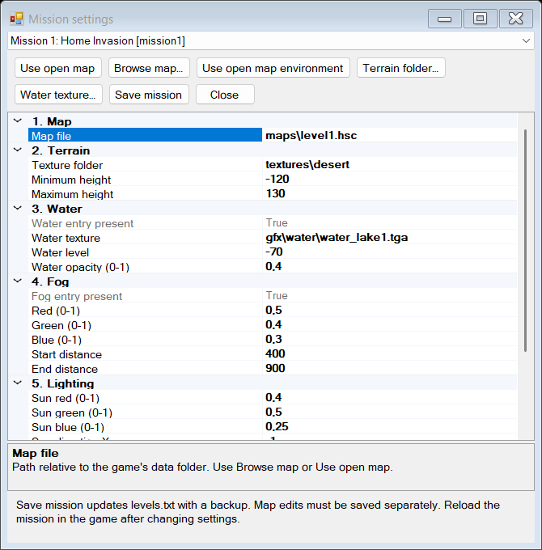
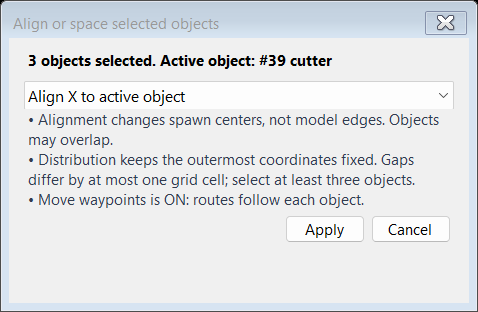
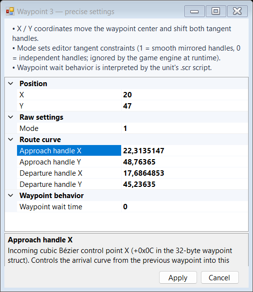
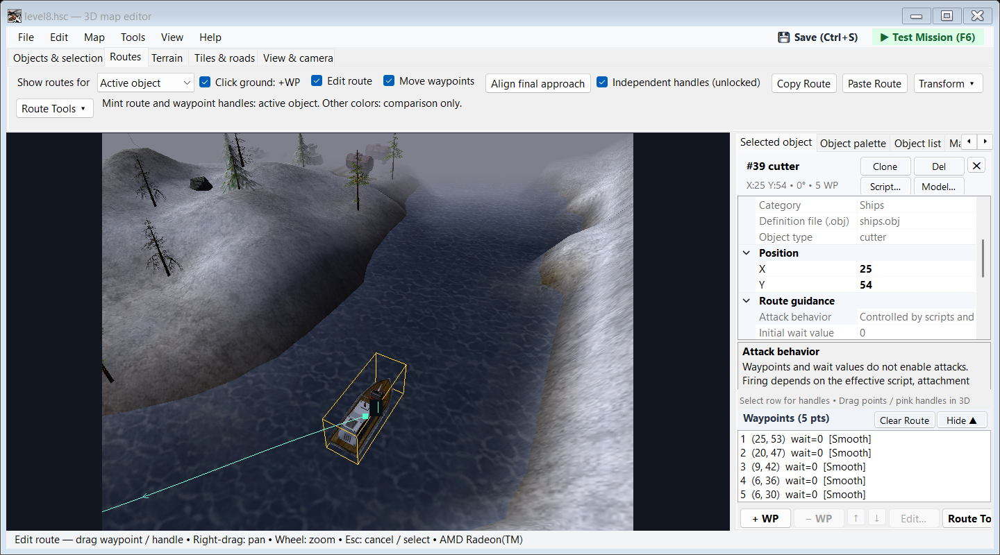
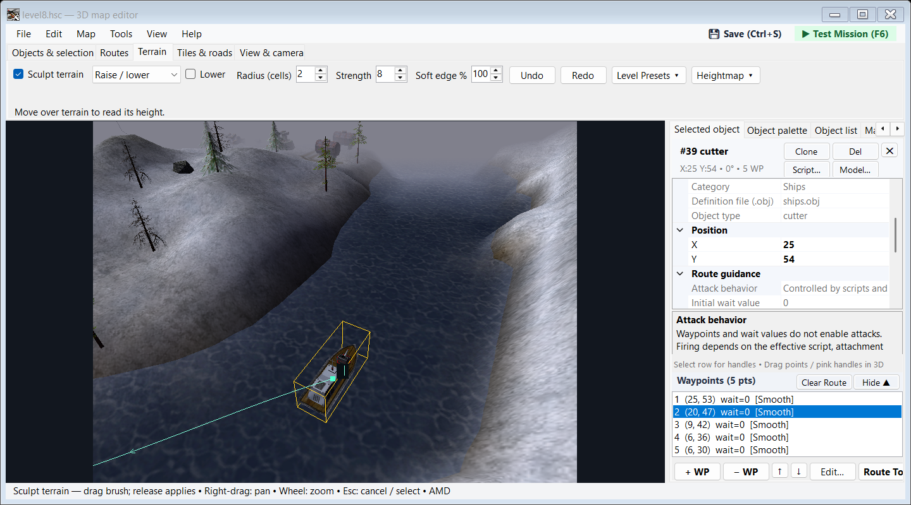
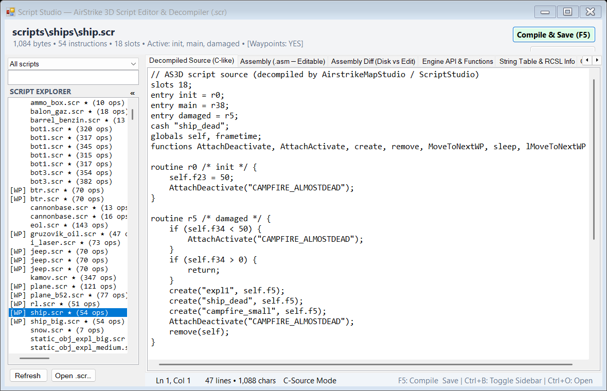

# AirStrike 3D Map Studio — Comprehensive User Manual & Reference Guide

**AirStrike 3D Map Studio** is a high-performance 3D level editor, terrain sculptor, route authoring suite, and script development environment designed for the **AirStrike 3D**, **AirStrike II**, and **AirStrike II: Gulf Thunder** helicopter combat engine.



---

## Table of Contents
1. [Getting Started & Quick Start](#1-getting-started--quick-start)
2. [3D Viewport & Camera Navigation](#2-3d-viewport--camera-navigation)
3. [Objects & Selection System](#3-objects--selection-system)
4. [Interactive 3D Transform Gizmo](#4-interactive-3d-transform-gizmo)
5. [Complete Submenu & Dialog Reference](#5-complete-submenu--dialog-reference)
   - [5.1 Main Menu Bar Submenus (File, Edit, Map, Tools, View, Help)](#51-main-menu-bar-submenus)
   - [5.2 Toolbar Dropdown Submenus (Duplicate ▾, Transform ▾, Group ▾)](#52-toolbar-dropdown-submenus)
   - [5.3 Routes Tab Submenus (Transform ▾, Route Tools ▾)](#53-routes-tab-submenus)
   - [5.4 Terrain Tab Submenus (Level Presets ▾, Heightmap ▾)](#54-terrain-tab-submenus)
   - [5.5 Precision Dialogs & Inspectors](#55-precision-dialogs--inspectors)
6. [Routes & Waypoint Authoring](#6-routes--waypoint-authoring)
7. [Terrain Sculpting & Heightmaps](#7-terrain-sculpting--heightmaps)
8. [Tiles & Road Painting](#8-tiles--road-painting)
9. [Script Studio & Bytecode Tools](#9-script-studio--bytecode-tools)
10. [One-Click Test Mission (F6)](#10-one-click-test-mission-f6)
11. [Complete Keyboard Shortcuts Reference](#11-complete-keyboard-shortcuts-reference)

---

## 1. Getting Started & Quick Start

### System Architecture
AirStrike Map Studio communicates directly with the binary `.hsc` mission format used by the game engine. All reads, mutations, and writes guarantee **bit-exact serialization**, preserving original object definitions, link values, scripting references, and unusual waypoint flags.

### Opening & Creating Maps
- **New Map (`Ctrl+N`)**: Generates a blank map grid (default 32×256) with selectable environment presets (Desert, Archipelago, Industrial, Night Canyon).
- **Open Map (`Ctrl+O`)**: Loads any `.hsc` file from AirStrike 3D, AirStrike II, or Gulf Thunder.
- **Save Map (`Ctrl+S`) / Save Map As (`Ctrl+Shift+S`)**: Saves the current map. When modifying an existing game file, automatic timestamped backups are preserved.
- **Mission Settings (`F4`)**: Configures mission environment parameters, skybox texture, lighting color, water elevation, and player vehicle assignment.
- **Map Diagnostics (`F5`)**: Validates fog boundaries, route constraints, object spawn ranges, and script integrity.

---

## 2. 3D Viewport & Camera Navigation

The 3D workspace renders with an authentic OpenGL fixed-pipeline recreating the game's perspective projection ($60^\circ$ vertical FOV, 4:3 aspect letterboxing).

| Navigation Action | Mouse / Keyboard Input | Description |
| :--- | :--- | :--- |
| **Orbit Camera** | Left-Click Drag on ground | Rotates camera **Heading** ($0^\circ \dots 360^\circ$) and **Pitch** ($10^\circ \dots 85^\circ$). |
| **Pan Camera** | Right-Click Drag or Middle-Click Drag | Smoothly shifts view center across the map grid. |
| **Zoom In / Out** | Mouse Wheel Scroll | Smooth exponential zoom from 100 to 100,000 units. |
| **Focus Selection** | `Ctrl + F` | Smoothly centers and frames the camera onto the currently selected object. |
| **Fit Entire Map** | Menu: *View → Fit Entire Map* | Pulls camera back to frame the full map boundary. |
| **Top-Down Camera** | Menu: *View → Top-Down Camera* | Snaps camera to $85^\circ$ overhead bird's-eye view. |
| **Reset Camera Angle**| `Home` key | Resets camera to default game angle ($45^\circ$ pitch, $-90^\circ$ heading). |
| **Save Screenshot** | View Toolbar → *Save screenshot* | Renders a clean frame buffer capture to a 32-bit PNG image. |
| **Mission Fog** | View Toolbar → *Mission fog* | Toggles preview of the engine's linear distance fog. |
| **Animate Water** | View Toolbar → *Animate water* | Simulates the dynamic sinusoidal wave motion of the water surface. |

---

## 3. Objects & Selection System

The editor allows individual object placement, group manipulation, precision coordinate snapping, and batch editing.

### Selection Modes
- **Single Click**: Click any 3D model in the viewport to select it. The selected object is highlighted with a 3D yellow bounding box and displays the interactive 3D Transform Gizmo.
- **Multi-Selection (`Ctrl + Click`)**: Hold `Ctrl` while clicking objects to add or remove them from the active selection group.
- **Box Marquee Selection**: Check **Box select** on the toolbar or press `B`. Left-drag a marquee rectangle across the screen. Hold `Ctrl` to toggle enclosed models.
- **Overlap Disambiguation (`Alt + Click`)**: If multiple objects overlap tightly (e.g. gun turrets placed on building roofs or ship decks), hold `Alt` and left-click to open the **Overlap Chooser popup**, displaying a categorized list of all models under the cursor.



### Consolidated Objects & Selection Toolbar
All object actions are consolidated onto a clean single-row toolbar:

```
[ (Recent obj... ▾ ] | [ Add object… ] [ Replace… ] | [ Duplicate ▾ ] [ Delete ] [ Deselect ] | [ Transform ▾ ] [ Group ▾ ] | [☑ 3D Gizmo] [☐ Grid snap] [☐ Move drag] [☐ Box select]
```

---

## 4. Interactive 3D Transform Gizmo

When exactly one object is selected in standard editing mode, an **interactive 3D Transform Gizmo** appears centered at the object's origin.

```
       ▲ +Y (Green Arrow)
       │
   ┌───┼───┐  Rotation Ring (Cyan / Gold)
  ╱    │    ╲
 ◄─────◆─────► +X (Red Arrow)
  ╲  Center ╱  (Diamond Handle)
   └───┼───┘
       │
```

### Gizmo Handles & Behaviors:
- **Red Arrow ($+X$ Axis)**:
  - Hovering highlights the arrow in bright yellow and sets the cursor to `↔ SizeWE`.
  - Left-drag translates the object strictly along the **X axis**, locking $Y$. Supports grid snap.
- **Green Arrow ($+Y$ Axis)**:
  - Hovering highlights the arrow in bright yellow and sets the cursor to `↕ SizeNS`.
  - Left-drag translates the object strictly along the **Y axis**, locking $X$. Supports grid snap.
- **Center Diamond Handle**:
  - Hovering highlights the diamond and sets the cursor to `✥ SizeAll`.
  - Left-drag allows free planar movement across the terrain surface.
- **Cyan & Gold Rotation Ring**:
  - Features **12 radial tick marks** representing AirStrike's 12 facing sectors ($0^\circ, 30^\circ, 60^\circ, \dots, 330^\circ$).
  - An outward-pointing **gold arrow** indicates the current facing direction.
  - Hovering highlights the ring and sets the cursor to `✢ Cross`.
  - Left-drag calculates the cursor angle relative to center and snaps to the nearest $30^\circ$ sector with live visual model rotation.
- **Undo Integration**: Releasing the mouse commits the entire transformation as a single undo step (`Ctrl+Z`). Pressing `Escape` during a drag cancels and restores the initial position.

---

## 5. Complete Submenu & Dialog Reference

This section documents every menu, dropdown sub-menu, and modal dialog in the application.

### 5.1 Main Menu Bar Submenus

Located at the top of the editor window:

#### File Menu
- **New Map… (`Ctrl + N`)**: Prompts to create a new empty map grid with specified dimensions (Width × Height) and environment preset (e.g., Archipelago, Desert, Night).
- **Open Map… (`Ctrl + O`)**: Opens a file browser to select and load an existing `.hsc` file.
- **Save Map (`Ctrl + S`)**: Saves the active mission. If editing an original game file, automatically writes a safety backup to `data\maps\backup\`.
- **Save Map As… (`Ctrl + Shift + S`)**: Saves the current map under a new filename.
- **Close 3D View (`Alt + F4`)**: Safely exits the editor, prompting to save if changes are unsaved.

#### Edit Menu
- **Undo (`Ctrl + Z`)**: Reverses the last action (movement, placement, deletion, sculpting stroke, or tile brush).
- **Redo (`Ctrl + Y`)**: Re-applies the last undone operation.
- **Shared Settings…**: Opens the batch property editor for multi-selected objects (enabled when 2+ objects are selected).
- **Drop-Item Table…**: Opens the level's drop table dialog, displaying every collectible item referenced in this mission and its usage count across placed enemies/crates.

#### Map Menu
- **Mission Settings… (`F4`)**: Opens the mission configuration window:
  - *Player Ship*: Select player craft (Apache, Havoc, Hokum, etc.).
  - *Skybox Texture*: Chooses panoramic background sky.
  - *Mission Fog*: Sets linear fog start distance, end distance, and RGB fog color.
  - *Water Surface Elevation*: Configures water plane height ($Z$ elevation) and transparency.



- **Resize Map…**: Resizes the terrain grid (e.g. from 32×256 to 48×384) with anchor alignment (Top, Center, Bottom) and automatic terrain height interpolation.
- **Check Map / Diagnostics… (`F5`)**: Scans the entire mission for fatal errors and warnings:
  - Checks for out-of-bounds object spawns.
  - Verifies waypoints do not fly backwards into spawns.
  - Checks for missing or unresolvable `.scr` script files.
  - Flags invalid fog configurations (fog start $\ge$ fog end).

#### Tools Menu
- **Test Mission (F6)**: Automatically discovers installed AirStrike games, hot-swaps your custom map into Slot 1 of `levels.txt`, and launches the game directly into your level for playtesting. Restores original files automatically upon exit.
- **Script Studio…**: Opens the integrated `.scr` disassembler, compiler, and bytecode inspector.
- **Model Inspector…**: Launches the standalone 3D model inspector tool (`AS3DModelTool.exe`) to view socket attachment tags (rotors, turrets, missile racks).

#### View Menu
- **Focus Selection (`Ctrl + F`)**: Center camera on active selection.
- **Fit Entire Map**: Frame entire level boundary.
- **Top-Down Camera**: Snap to $85^\circ$ overhead view.
- **Reset Camera Angle (`Home`)**: Restore default game view angle ($45^\circ$ pitch, $-90^\circ$ heading).
- **Toggle Grid Snap**: Enables/disables cell snapping for object moves and waypoints.
- **Toggle Route Display**: Cycles route visibility between *Active Object*, *Selected Group*, and *All Objects*.
- **Show 3D Transform Gizmo**: Toggles the interactive 3D gizmo on/off.
- **Mode Shortcuts**: Quick switch to *Objects & selection*, *Routes*, *Terrain*, *Tiles & roads*, *View & camera*, or *Assets & export*.

#### Help Menu
- **Keyboard Shortcuts & Guide (`F1`)**: Opens the comprehensive in-app editor manual.
- **About AirStrike 3D Map Studio**: Displays build version and engine compatibility details.

---

### 5.2 Toolbar Dropdown Submenus

#### Duplicate ▾ Submenu
Located on the *Objects & selection* toolbar:
- **Interactive Duplicate (`Ctrl + D`)**: Arms duplicate placement. Left-click anywhere on the terrain to stamp a duplicate of the selection. Press `Escape` to cancel.
- **Clone +2, +2 (Instant)**: Clones the selection immediately, shifting its coordinates by $+2$ cells along $X$ and $Y$. Ideal for building enemy convoys or building clusters.
- **Duplicate to (Coordinates)…**: Opens the precision translation dialog in clone mode, allowing you to enter exact numerical destination coordinates while preserving the relative spacing of multi-object groups.

#### Transform ▾ Submenu
Located on the *Objects & selection* toolbar:
- **Rotate Left 30° (`[` or `R`)**: Rotates selected object facing counter-clockwise by $30^\circ$ (1 sector).
- **Rotate Right 30° (`]` or `Shift + R`)**: Rotates selected object facing clockwise by $30^\circ$ (1 sector).
- **Rotate Group…**: Opens the group rotation dialog for multi-selected objects:
  - *Pivot Choice*: Rotate around the primary object's spawn point or around the group's geometric midpoint.
  - *Angle*: Specify arbitrary rotation angles in increments of $30^\circ$.
  - *Rotate Routes Checkbox*: When checked, automatically rotates all attached waypoints and curve handles to match the new orientation.

#### Group ▾ Submenu (Align & Group)
Located on the *Objects & selection* toolbar:
- **Align / Space Selection…**: Opens the multi-object alignment dialog with 4 layout operations:
  - *Align X to active object*: Lines up all selected objects along the $X$ axis of the primary selected object.
  - *Align Y to active object*: Lines up all selected objects along the $Y$ axis of the primary selected object.
  - *Distribute along X*: Evenly spaces 3 or more objects along the horizontal axis between the outermost coordinates.
  - *Distribute along Y*: Evenly spaces 3 or more objects along the vertical axis between the outermost coordinates.



- **Move Selection to (Coordinates)…**: Moves the entire selected group so the primary object lands at specified $(X, Y)$ grid coordinates, shifting all other selected objects to maintain their relative distances.
- **Shared Settings (Batch Edit)…**: Opens a batch editing dialog modifying only checked attributes across all selected objects:
  - Batch set Drop Item.
  - Batch set Initial Facing sector.
  - Batch toggle Route Looping (Once, Infinite, Patrol).
  - Batch set Link IDs.

---

### 5.3 Routes Tab Submenus

Located on the *Routes* toolbar:

#### Transform ▾ Submenu (Routes)
- **Reverse Route Direction**: Inverts the waypoint traversal order (the final waypoint becomes the first, and all tangent handles flip direction). Useful for creating return patrols.
- **Smooth Bezier Curve**: Recalculates natural smooth Catmull-Rom tangent handles across all waypoints, eliminating sharp angles. Hold `Shift` while clicking to apply relaxed smoothing.
- **Rotate Route…**: Opens route rotation dialog:
  - *Pivot Choice*: Rotate path around object spawn, first waypoint, or geometric curve center.
  - *Maintain Object Facing Checkbox*: When checked, turns only the flight trajectory while leaving the object's spawn facing unchanged.

#### Route Tools ▾ Submenu
- **Set All Wait Times…**: Opens a dialog to set the wait delay across all waypoints in the active route simultaneously (e.g. set all to 0 for continuous flight, or set a uniform delay for convoy pauses).
- **Export Route to CSV…**: Exports the active flight path into an editable `.csv` file. The file includes a `# SpawnX=..., SpawnY=...` metadata header and columns for `X, Y, Mode, AX, AY, BX, BY, Wait`.
- **Import Route from CSV…**: Imports a route from CSV, parsing coordinates with tolerance for external spreadsheet editing.

---

### 5.4 Terrain Tab Submenus

Located on the *Terrain* toolbar:

#### Level Presets ▾ Submenu
- **Carve Water Level (Lakes & Seas)**: Automatically sets the brush height target to the exact water elevation configured in Mission Settings ($Z = \text{WaterLevel}$). Applying the brush flattens terrain directly to water surface level, creating natural rivers, lakes, and ocean shorelines.
- **Level 0 (Floor)**: Sets target height to absolute minimum elevation (0).
- **Level 64 (Lowland)**: Sets target height to low elevation plateau.
- **Level 128 (Midland)**: Sets target height to standard mid-altitude plateau.
- **Level 192 (Highland)**: Sets target height to elevated ridge plateau.
- **Level 255 (Peak)**: Sets target height to maximum mountain peak elevation (255).

#### Heightmap ▾ Submenu
- **Export Grayscale PNG…**: Generates an 8-bit or 16-bit grayscale PNG representation of the entire map's elevation grid ($0 = \text{black/lowest}, 255 = \text{white/highest}$). Compatible with external editors like Photoshop, GIMP, World Machine, and Blender.
- **Import Grayscale PNG…**: Prompts to select a grayscale image and bilinearly interpolates its pixel luminance values across the map grid, replacing the terrain geometry in a single click with full undo support.

---

### 5.5 Precision Dialogs & Inspectors

#### Waypoint Precise Settings Inspector
Accessed by double-clicking any waypoint row in the sidebar:
- **Position ($X, Y$)**: Grid coordinate of the waypoint center.
- **Raw Settings (Mode)**: Tangent handle constraint:
  - `Mode = 1`: Mirrored smooth handles. Moving Handle A symmetrically mirrors Handle B.
  - `Mode = 0`: Independent corner handles. Tangents can be bent at sharp angles.
- **Route Curve Tangents**:
  - `Approach handle (AX, AY)`: Incoming flight tangent.
  - `Departure handle (BX, BY)`: Outgoing flight tangent.
- **Waypoint Behavior (Wait Time)**: Delay in engine frames/ticks before the unit departs this waypoint.
- **Auto-Scaling Help Comments**: The documentation box at the bottom automatically measures text length and resizes dynamically so parameter descriptions are never cut off by `...`.



#### Drop-Item Table Dialog
Accessed via *Edit → Drop-Item Table…*:
- Lists all drop pickups defined in the map (Lives, Weapons, Missiles, Score crates).
- Shows how many objects on the map currently drop each item.
- **Remap / Replace**: Change all occurrences of one drop type to another in a single operation.
- **Usage Audit**: Identifies unused drop table entries.

---

## 6. Routes & Waypoint Authoring

AirStrike missions rely on cubic Bezier curves for enemy flight paths, ground patrols, naval convoys, and boss movement.



```
Waypoint A (Handle) ──── Waypoint Center (Point) ──── Waypoint B (Handle)
    [Cyan Handle]              [White Square]              [Coral Pink Handle]
```

### Route Overlay & Display Scopes
- **Show routes for**:
  - *Active object*: Shows only the selected object's route.
  - *Selected group*: Displays routes for all currently selected objects.
  - *All objects*: Renders every flight path on the map for overall traffic analysis.
- **Route Colors**:
  - The active object's route renders in **Mint Green** with numbered waypoint badges.
  - Other routes render in alternating comparison colors (Gold, Lavender, Coral, Azure).
  - Dashed lines connect the object's ground spawn point to its initial waypoint.

### Route Editing Workflow
1. Select the object, switch to the **Routes** tab, and check **Edit route**.
2. **Appending Waypoints**:
   - Check **Click ground: +WP** (or hold `Shift` and click the map).
   - Click anywhere on the terrain to continuously append smooth curve points.
3. **Manipulating Handles**:
   - **Waypoint Center (White)**: Drag to translate the waypoint position.
   - **Handle A (Cyan)**: Departure/incoming curvature tangent.
   - **Handle B (Coral Pink)**: Arrival/outgoing curvature tangent.
4. **Tangent Modes**:
   - **Smooth / Mirrored Mode (`Mode = 1`)**: Moving Handle A symmetrically mirrors Handle B, ensuring continuous tangent velocity.
   - **Independent / Corner Mode (`Mode = 0`)**: Allows sharp turns; handles move independently. Check **Independent handles (unlocked)** or hold `Alt` to decouple.

---

## 7. Terrain Sculpting & Heightmaps

The **Terrain** tab turns the editor into a real-time 3D terrain sculptor.



### Sculpting Modes
- **Raise / Lower**: Left-drag raises terrain; hold `Shift` and drag to lower.
- **Smooth**: Equalizes elevation discrepancies across adjacent vertices to eliminate steep cliffs.
- **Level / Flatten**: Levels surrounding terrain toward a target elevation.
  - Hold `Alt` and click anywhere to sample the ground elevation into the target slider.

### Brush Properties
- **Radius**: Brush diameter in grid units ($1 \dots 32$). Quick keys: `[` to shrink, `]` to enlarge.
- **Strength**: Rate of height deformation per tick ($1 \dots 100\%$).
- **Soft Edge**: Falloff curve (Gaussian/Cosine transition) preventing sharp jagged borders.

---

## 8. Tiles & Road Painting

The **Tiles & roads** tab manages texture atlas stamping across the terrain surface.

### Painting Controls
- **Tile Palette**: Displays visual texture previews of grass, sand, rock, asphalt roads, dirt trails, and metal grating.
- **Paint Tool**: Left-click and drag across terrain cells to stamp the active texture.
- **Rotate Tile (`R`)**: Rotates the texture orientation by $90^\circ$ increments ($0^\circ, 90^\circ, 180^\circ, 270^\circ$).
- **Erase Mode**: Reverts painted cells back to the map's default ground tile.
- **Sample Tile (`Alt + Click`)**: Eye-dropper tool that samples whatever tile is currently under the cursor.

---

## 9. Script Studio & Bytecode Tools

AirStrike uses compiled `.scr` script files for custom AI behaviors, boss phase routines, trigger activations, and cinematic sequences.



### Opening Script Studio
Select any object with an attached script and click **Script…** in the right-hand inspector, or press `Ctrl + Alt + S`.

### Capabilities:
- **Disassembler**: Decompiles binary `.scr` bytecode into readable assembly instructions (`r0`, `r10`, variable slots, engine calls).
- **Native C-like Source Compiler**: Edit source logic directly with high-level `if / else`, function calls (`MoveToNextWP`, `AttachDeactivate`, `Random`), and loop constructs, then click **Compile** to re-encode clean bytecode.
- **Visual Attachment Inspector**: View and configure multi-part models (e.g. spinning helicopter rotors, tank turrets, rocket racks) with exact socket tag alignment.

---

## 10. One-Click Test Mission (F6)

The editor features a built-in game launcher pipeline allowing you to playtest your exact map in the actual game engine with a single keypress.

### How it works:
1. Press `F6` (or click **▶ Test Mission (F6)** in the top right menu).
2. The editor automatically discovers installed AirStrike games (`AirStrike II Gulf Thunder`, `AirStrike 3D`, `AirStrike II`).
3. It temporarily hot-swaps your custom map into Slot 1 of `levels.txt` and records a safety journal.
4. The game launches directly into your level.
5. Upon exit, the editor automatically restores original game files with **zero file corruption risk**.

---

## 11. Complete Keyboard Shortcuts Reference

| Shortcut | Context | Function |
| :--- | :--- | :--- |
| `Ctrl + N` | Global | Create a New Map |
| `Ctrl + O` | Global | Open Map file (`.hsc`) |
| `Ctrl + S` | Global | Save Map |
| `Ctrl + Shift + S` | Global | Save Map As |
| `Ctrl + Z` | Global | Undo last action |
| `Ctrl + Y` | Global | Redo last undone action |
| `F1` | Global | Open Help Guide |
| `F4` | Global | Open Mission Settings (Sky, Fog, Player) |
| `F5` | Global | Run Map Checks & Diagnostics |
| `F6` | Global | Playtest Map in Game (**Test Mission**) |
| `Ctrl + F` | 3D Viewport | Focus / Frame camera on selection |
| `Home` | 3D Viewport | Reset camera angle to default game angle |
| `Left-Drag` | 3D Viewport | Orbit camera (Heading & Pitch) |
| `Right-Drag` | 3D Viewport | Pan camera across map |
| `Mouse Wheel` | 3D Viewport | Zoom camera in / out |
| `Left-Click` | 3D Viewport | Select object under cursor |
| `Ctrl + Click` | 3D Viewport | Toggle object in selection group |
| `Alt + Click` | 3D Viewport | Overlap Chooser (disambiguate stacked models) |
| `Ctrl + D` | Objects | Arm Interactive Duplicate |
| `Del` / `Backspace`| Objects | Delete selected object(s) |
| `[` / `]` | Objects / Gizmo | Rotate facing $-30^\circ$ / $+30^\circ$ |
| `R` / `Shift + R` | Objects / Gizmo | Rotate facing $+30^\circ$ / $-30^\circ$ |
| `[` / `]` | Terrain | Decrease / Increase brush radius |
| `Alt + Click` | Terrain / Tiles| Sample terrain height / Sample ground tile |
| `Shift + Click` | Routes | Append new waypoint at cursor position |
| `Escape` | Global | Cancel drag, abort pending tool, or deselect |
