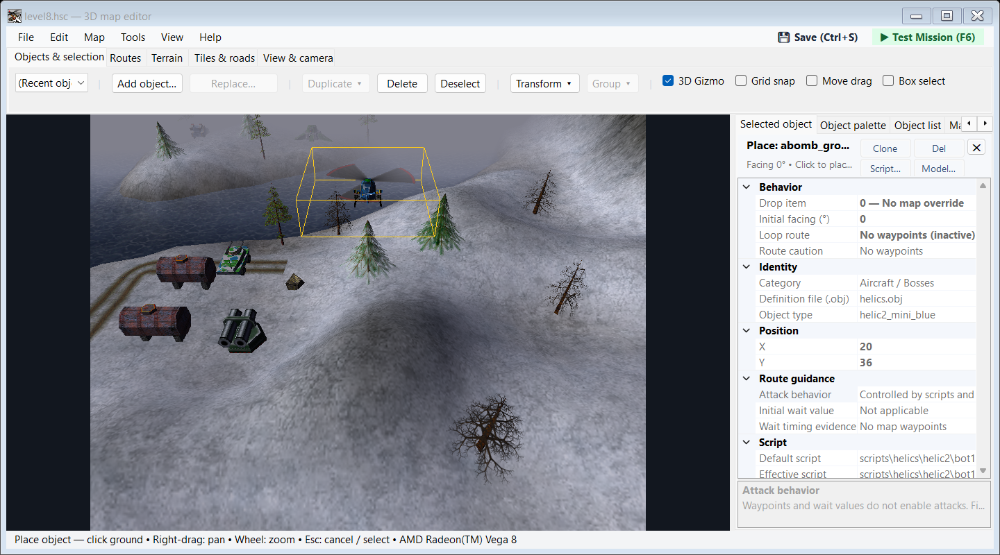
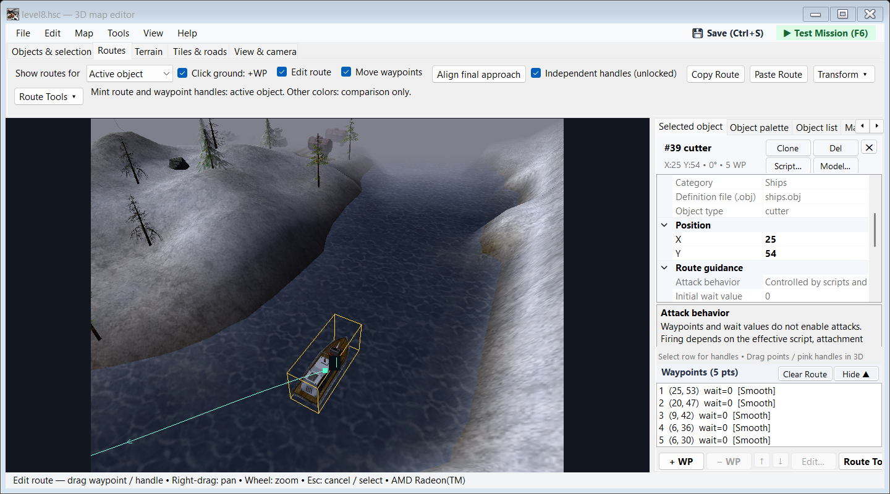
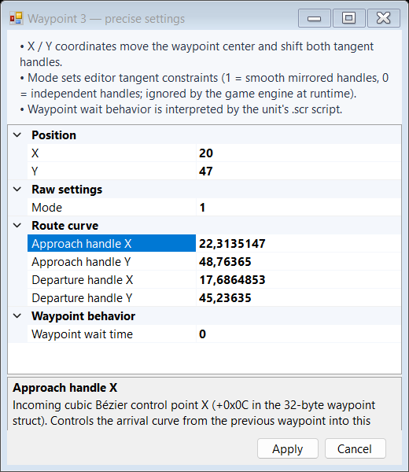
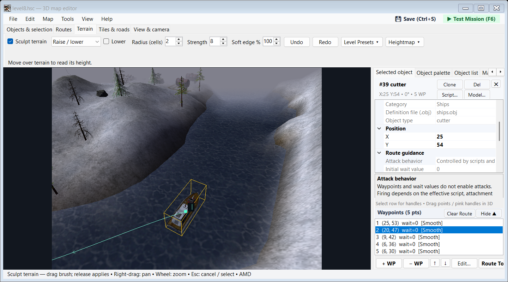
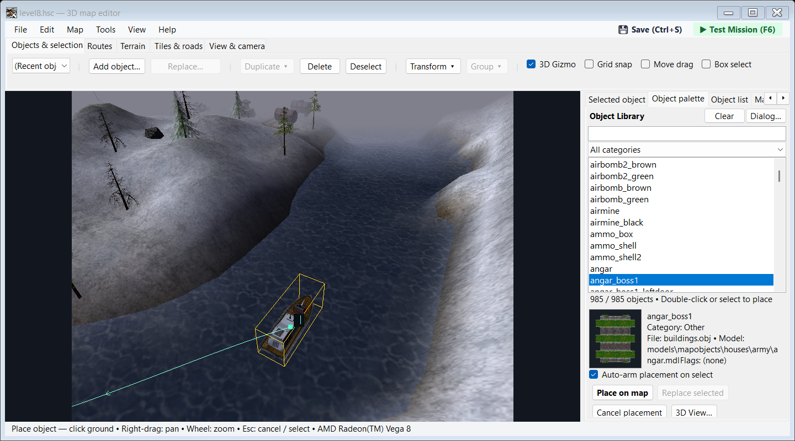
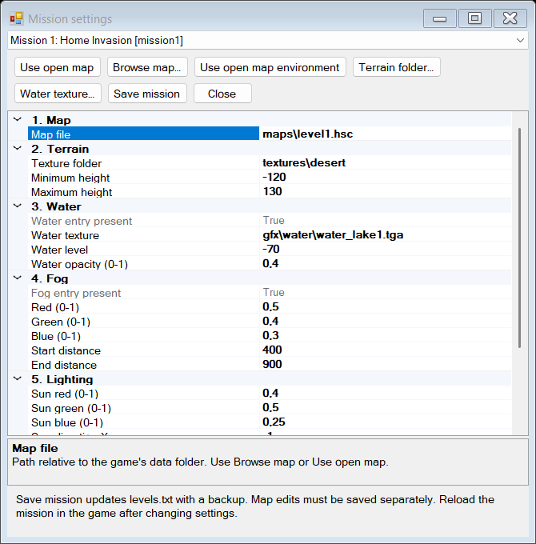
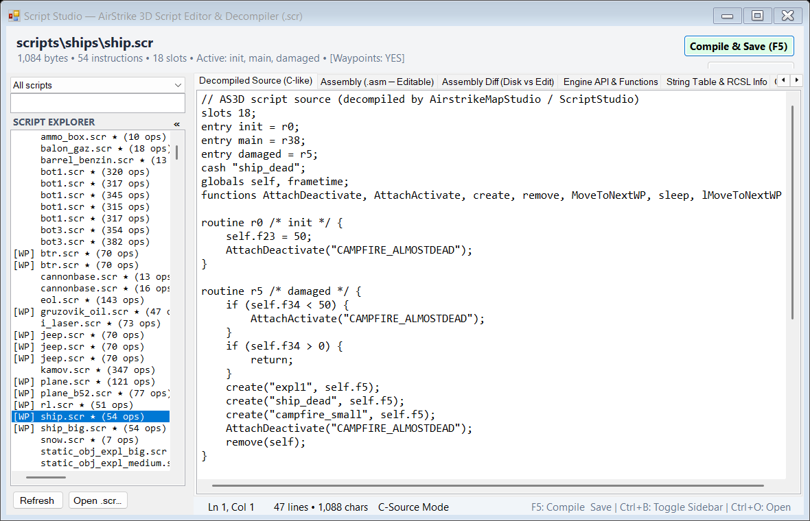

# AirStrike 3D Map Studio & Script Editor

[](https://github.com/alfypeol/AirStrikeStudio/releases/latest)
[](https://github.com/alfypeol/AirStrikeStudio/releases)
[]()
[]()
[]()
[]()
[](LICENSE)

**AirStrike 3D Map Studio** is an advanced, high-performance 3D level editor, real-time terrain sculptor, Bézier flight route authoring suite, and script development environment designed specifically for the DivoGames helicopter combat engine:
- **AirStrike 3D** (2002)
- **AirStrike II** (2003)
- **AirStrike II: Gulf Thunder** (2004)



---

## Key Features

### 1. Authentic 3D OpenGL Viewport
- **Engine-Accurate Perspective**: Fixed-pipeline hardware OpenGL reproducing the original game engine's projection ($60^\circ$ vertical FOV, 4:3 aspect ratio letterboxing).
- **Realistic Environment Simulation**: Real-time sinusoidal water wave animations, customizable distance fog, and skybox lighting.
- **Fluid Camera Controls**: Left-drag orbital rotation (Heading & Pitch), Right-drag ground panning, smooth wheel zoom, and `Ctrl + F` selection focus.

### 2. Interactive 3D Transform Gizmo
- **Precision Translators**: Red $+X$ and Green $+Y$ axis constraint handles with pixel-accurate screen-space raycasting and grid snapping.
- **Center Diamond**: Free planar movement across the terrain surface.
- **12-Sector Rotation Ring**: Radial tick marks for AirStrike's 12 facing sectors ($0^\circ, 30^\circ, 60^\circ, \dots, 330^\circ$) with an outward gold pointer and live model drag preview.
- **Single Undo Integration**: Transformations cleanly commit as a single undo step (`Ctrl + Z`).

### 3. Streamlined Single-Row Toolbar
- Consolidates 23 separate controls into a modern, uncluttered single row with dropdown sub-menus:
  - `Duplicate ▾`: Interactive clone stamp, instant `Clone +2, +2`, and precision offset translation.
  - `Transform ▾`: $30^\circ$ left/right facing rotations and multi-unit group rotation with route pivoting.
  - `Group ▾`: `Align / Space Selection…` (Align X, Align Y, Distribute X, Distribute Y), `Move Selection to…`, and batch `Shared Settings…`.

### 4. Bézier Route & Waypoint Authoring
- **Cubic Bézier Navigation**: Full visual flight paths with numbered waypoints, **Handle A (Cyan)** arrival tangents, and **Handle B (Coral Pink)** departure tangents.
- **Curve Algorithms**: One-click Catmull-Rom smoothing (`Smooth Bezier Curve`), route direction reversal, and path rotation.
- **Auto-Scaled Precise Settings**: Dynamic description auto-measurement ensuring parameter documentation is never truncated.
- **CSV Data Exchange**: Full route export and import with external spreadsheet tools.

### 5. 3D Terrain Sculpting & Heightmaps
- **Dynamic Brushes**: Real-time `Raise / Lower`, `Level / Flatten` (with Alt-click ground height sampling), `Smooth`, `Noise`, and 2-click `Ramp / Slope`.
- **Water Level Presets**: One-click brush targeting matching the map's exact water elevation ($Z = \text{WaterLevel}$) for carving lakes and rivers.
- **Heightmap Import / Export**: Lossless 8-bit / 16-bit grayscale PNG heightmap interchange with Photoshop, GIMP, Blender, and World Machine.

### 6. Script Studio (.scr) IDE
- **Lossless Decompiler**: Decompiles binary `.scr` files into clean, readable C-like high-level structured code.
- **Native C-Compiler**: Edit logic directly with `if/else`, `while`, mathematical functions, and unit triggers; compiles directly to verified RCSL bytecode on `F5`.
- **Engine API Explorer**: Live searchable catalog of all built-in host functions with signatures, argument counts, and call frequencies.

### 7. One-Click Playtesting (Test Mission — F6)
- Automatically detects installed AirStrike games, safely hot-swaps your custom map into Slot 1 of `levels.txt`, and launches the game directly into your level.
- Automatically restores original game files upon exit with zero file corruption risk.

### 8. Bit-Exact Serialization
- All reads and writes preserve original object types, link values, scripting references, and unusual waypoint flags bit-for-bit.

---

## Visual Showcase

| Routes & Bézier Tangents | Waypoint Precise Inspector |
| :---: | :---: |
|  |  |
| *Visual flight curves with Handle A (Cyan) and Handle B (Coral Pink)* | *Auto-scaling property grid with complete, un-truncated help text* |

| Terrain Sculptor & 3D Brush | Object Palette & 3D Previews |
| :---: | :---: |
|  |  |
| *Real-time elevation deformation with Water Level presets* | *Categorized unit library with live 3D thumbnail generation* |

| Mission Settings (F4) | Script Studio & Decompiler (Ctrl+Alt+S) |
| :---: | :---: |
|  |  |
| *Skybox, fog boundaries, water elevation, and player vehicle* | *Integrated C-like script editor, bytecode compiler & API catalog* |

---

## Documentation

Comprehensive documentation guides are included in the repository:
- **[Map Editor User Manual & Reference Guide](MAP_EDITOR_MANUAL.md)**: Complete guide to 3D navigation, selection tools, submenus, dialogs, terrain sculpting, road painting, and keyboard shortcuts.
- **[Script Studio Technical Reference & RCSL Guide](SCRIPT_STUDIO_GUIDE.md)**: Deep architectural guide to the virtual machine, unit struct fields (`self.f5`, `self.f34`), engine functions catalog, opcodes, and 4 practical tutorials (destructible barrels, convoy trucks, attack helicopters, multi-phase bosses).

---

## Building from Source

### Prerequisites
- Windows 7 / 8 / 10 / 11 (32-bit or 64-bit)
- Visual Studio 2017, 2019, 2022 (or .NET SDK with MSBuild)
- .NET Framework 4.7.2 Developer Pack
- GPU supporting OpenGL 1.1 or higher

### Build via Command Line
```powershell
# Build Release x86 binary
dotnet msbuild AirstrikeMapStudio.sln -p:Configuration=Release -p:Platform=x86

# Run automated test suites
bin\x86\Release\AirstrikeMapStudio.exe --self-test "C:\Path\To\AirStrike"
```

### Build via Visual Studio
1. Open `AirstrikeMapStudio.sln` in Visual Studio.
2. Select **Release** configuration and **x86** platform.
3. Press `Ctrl + Shift + B` to build.
4. Output executable will be in `AirstrikeMapStudio\bin\x86\Release\AirstrikeMapStudio.exe`.

---

## Keyboard Shortcuts Reference

| Shortcut | Function | Shortcut | Function |
| :--- | :--- | :--- | :--- |
| `Ctrl + N` | New Map | `Ctrl + F` | Focus Selection in 3D View |
| `Ctrl + O` | Open Map (`.hsc`) | `Home` | Reset Camera to Default Angle |
| `Ctrl + S` | Save Map | `[` / `]` | Rotate Facing $-30^\circ$ / $+30^\circ$ |
| `F1` | Help & Keyboard Guide | `Alt + Click` | Overlap Chooser / Sample Tile / Ground |
| `F4` | Mission Settings Dialog | `Ctrl + D` | Interactive Duplicate Stamp |
| `F5` | Map Checks & Diagnostics | `Del` | Delete Selected Object(s) |
| `F6` | **Playtest Map (Test Mission)** | `Ctrl + Alt + S` | Open Script Studio IDE |

---

## License

This project is licensed under the [MIT License](LICENSE).
