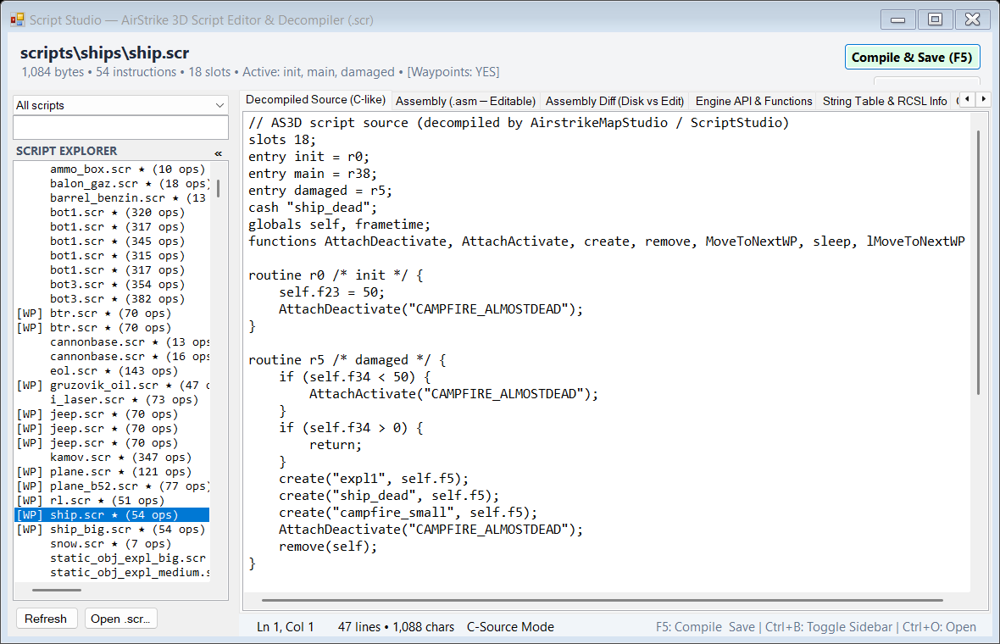
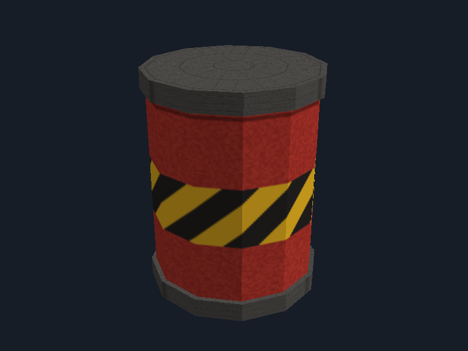
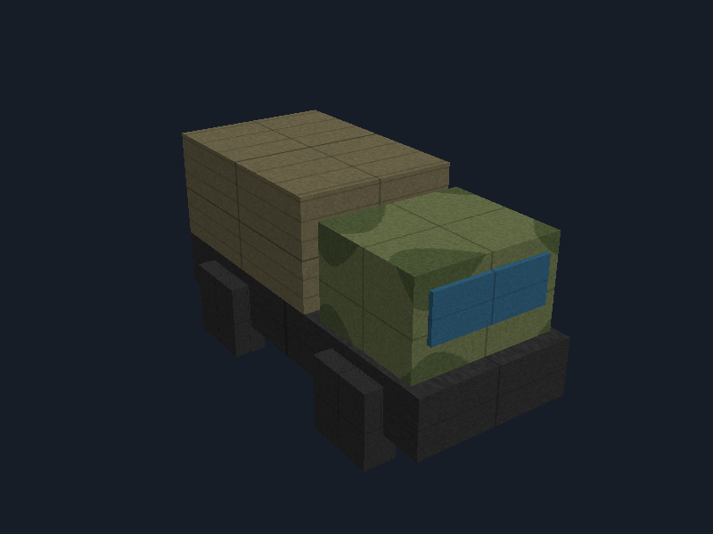
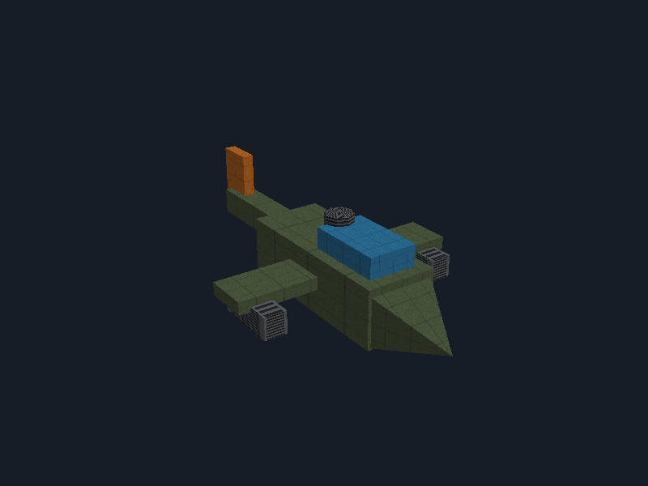
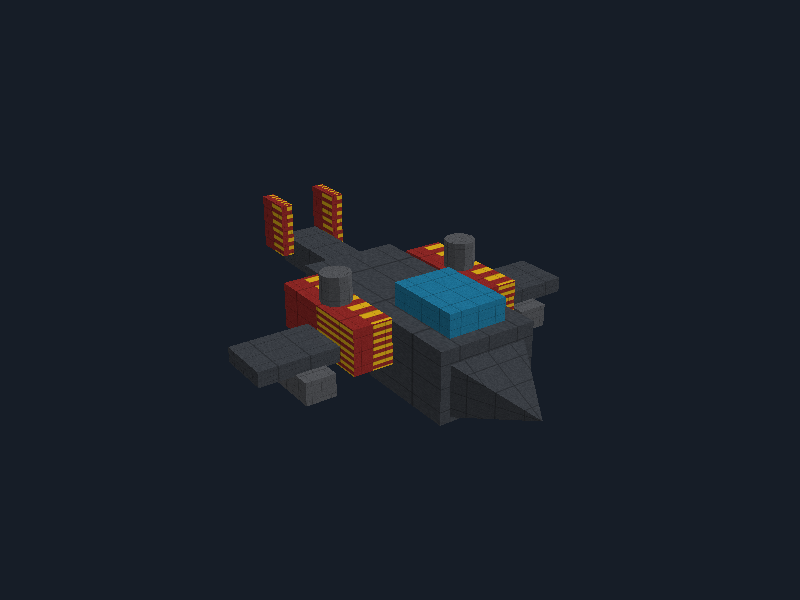

# AirStrike 3D Script Studio — Definitive Technical Reference & Scripting Guide

**AirStrike Script Studio** is the integrated compiler, disassembler, bytecode debugger, and language environment for the **AirStrike 3D**, **AirStrike II**, and **AirStrike II: Gulf Thunder** helicopter combat engine.

The game engine drives all enemy unit logic, boss encounter phases, flight routes, weapon behaviors, pickups, and cinematic scripting via compiled binary `.scr` files (the **RCSL** virtual machine).

---

## Table of Contents
1. [RCSL Virtual Machine & System Architecture](#1-rcsl-virtual-machine--system-architecture)
2. [Script Studio UI & Workflow](#2-script-studio-ui--workflow)
3. [Language Specification (C-Like Source)](#3-language-specification-c-like-source)
   - [3.1 Declarations & Script Headers](#31-declarations--script-headers)
   - [3.2 Variables & Data Types](#32-variables--data-types)
   - [3.3 Unit Structure Fields (`self`, `player`, `other`)](#33-unit-structure-fields)
   - [3.4 Control Flow & Routines](#34-control-flow--routines)
   - [3.5 Latent Execution & Frame Delays (`latent`)](#35-latent-execution--frame-delays)
4. [Engine Entry Points & Lifecycle](#4-engine-entry-points--lifecycle)
5. [Complete Engine API Function Catalog](#5-complete-engine-api-function-catalog)
   - [5.1 Waypoint Navigation & Movement](#51-waypoint-navigation--movement)
   - [5.2 Combat, Targeting & Weapons](#52-combat-targeting--weapons)
   - [5.3 Entity Spawning, Models & Attachments](#53-entity-spawning-models--attachments)
   - [5.4 Math, Random & Trigonometry](#54-math-random--trigonometry)
   - [5.5 Game State, Camera & Audio](#55-game-state-camera--audio)
6. [Low-Level Bytecode & Assembly Specification (`.asm`)](#6-low-level-bytecode--assembly-specification)
7. [Step-by-Step Practical Tutorials with Full Code](#7-step-by-step-practical-tutorials)
   - [Tutorial 1: Explosive Fuel Drum / Destructible Prop](#tutorial-1-explosive-fuel-drum)
   - [Tutorial 2: Ground Convoy Patrol with Pause Delays](#tutorial-2-ground-convoy-patrol)
   - [Tutorial 3: Aggressive Attack Helicopter with Aimed Lasers](#tutorial-3-aggressive-attack-helicopter)
   - [Tutorial 4: Multi-Phase Boss Helicopter Encounter](#tutorial-4-multi-phase-boss-helicopter)
8. [Assigning, Compiling & Playtesting (F5 & F6)](#8-assigning-compiling--playtesting)

---

## 1. RCSL Virtual Machine & System Architecture

The AirStrike script engine uses a register-backed bytecode stack virtual machine executed per frame for each active entity on the map.

```
┌─────────────────────────────────────────────────────────────────┐
│                    AirStrike Simulation Loop                    │
└─────────────────────────────────────────────────────────────────┘
                               │
               ┌───────────────┼───────────────┐
               ▼               ▼               ▼
         [Spawn Event]   [Frame Tick]   [Impact Event]
               │               │               │
               ▼               ▼               ▼
         entry: init     entry: main     entry: damaged
         (routine r0)    (routine r10)   (routine r30)
               │               │               │
               └───────────────┼───────────────┘
                               ▼
┌─────────────────────────────────────────────────────────────────┐
│                   RCSL Virtual Machine Core                     │
│  • Registers r0..r15 (Expression evaluation stack)             │
│  • Slots v16..vN (Persistent script variables)                 │
│  • Globals ($self, $other, $frametime, $player, $camera)        │
│  • Engine API dispatcher (C++ Host Function Table)              │
└─────────────────────────────────────────────────────────────────┘
```

### Memory Layout
- **Registers `r0` – `r15`**: 16 temporary working registers used for expression evaluation and parameter passing.
- **Variable Slots `v16` – `vN`**: Persistent variable memory preserved between simulation frames.
- **Global Variables**: System pointers maintained directly by the C++ engine (`self`, `other`, `frametime`, `player`, `camera`, `g_map_pos`, `l_waterlevel`).

---

## 2. Script Studio UI & Workflow

Script Studio can be opened anytime inside **AirStrike 3D Map Studio** via:
- Selecting any unit in the map and clicking **Script…** in the property panel.
- Pressing `Ctrl + Alt + S` anywhere in the editor.
- Top Menu: *Tools → Script Studio…*.



### Studio Tabs:
1. **Decompiled Source (C-like)**: High-level structured C-syntax editor. Supports direct code edits and one-key compilation (`F5`).
2. **Assembly (`.asm — Editable`)**: Low-level symbolic bytecode mnemonics (`MOV`, `LOAD`, `CALL`, `JZ`, `JMP`).
3. **Assembly Diff (Disk vs Edit)**: Real-time side-by-side diff comparing working memory against the original file on disk.
4. **Engine API & Functions**: Searchable catalog (`Search API:` + **Insert Function**) of all built-in functions, exact argument counts, call frequencies, and documentation.
5. **String Table & RCSL Info**: Displays slot allocations, active entry points, string constant pool, and pre-cache asset manifests.
6. **Object Definitions (`.obj`)**: Displays the `.obj` definition blocks and script references associated with the active unit/script.

### Toolbar, `Tools ▾` Menu & Script Explorer:
- **Compile & Save (`F5`)**: Compiles the active C-like source or `.asm` tab directly into verified `.scr` bytecode and saves to disk.
- **Target Engine Selector**: Switches API validation and IntelliSense between `Target: Auto-Detect`, `Target: AirStrike 3D [85 Builtins]`, and `Target: Sequel / OpenAirStrike [101]`.
- **`📁 Scripts (Ctrl+B)` / Explorer**: Toggles the left Script Explorer sidebar, with **Refresh** and **Open .scr…** to load any external `.scr` file.
- **`Tools ▾` Dropdown**:
  - **Assign to Selected Map Unit**: Sets the active script as the **Script override** on the currently selected map object.
  - **New / Clone Script…**: Creates a new `.scr` by cloning an existing template script.
  - **Find in Script… (`Ctrl+F`)** / **Find & Replace… (`Ctrl+H`)** / **Go to Line… (`Ctrl+G`)**.
  - **Compile Source to ASM View**: Compiles the C-like source into the `.asm` tab for inspection without saving to disk.
  - **Export Decompiled C (`.c`)…** / **Export Assembly (`.asm`)…**: Exports the active script's source or assembly to a file.
  - **Open in External `ScriptStudio.py`…**: Launches the standalone Python `ScriptStudio` GUI (`scrstudio.py` / `scrstudio_gui.py`, backed by `scrcore.py`, `scrcomp.py`, `scrasm.py`, `scrdec.py`, and `scrsrc.py`).

### IDE Keyboard Shortcuts:
| Shortcut | Action | Description |
| :--- | :--- | :--- |
| **`F5` / `Ctrl + S`** | **Compile & Save** | Compiles C-source or assembly directly to verified binary `.scr` bytecode. |
| **`Ctrl + Z`** | **Undo** | Reliable multi-level snapshot undo. |
| **`Ctrl + Y` / `Ctrl + Shift + Z`** | **Redo** | Redoes previously undone changes. |
| **`Ctrl + /`** | **Toggle Comment** | Toggles line comments `//` on the current line or highlighted block. |
| **`Tab` / `Shift + Tab`** | **Indent / Outdent** | Indents or outdents selected multi-line blocks by 4 spaces. |
| **`Ctrl + F`** | **Find in Script** | Opens floating in-editor search bar with forward/backward wrap and match case. |
| **`Ctrl + H`** | **Find & Replace** | Expands search bar to replace individual occurrences or Replace All. |
| **`Ctrl + G`** | **Go to Line…** | Prompts for a line number and jumps cursor straight to target. |
| **`Ctrl + D`** | **Duplicate Line** | Clones current line directly beneath. |
| **`Alt + Up` / `Alt + Down`** | **Move Line** | Swaps current line with the line above or below it. |
| **`Ctrl + Space`** | **IntelliSense** | Opens function autocomplete popup with engine tags and parameter documentation. |
| **`Ctrl + B`** | **Toggle Sidebar** | Collapses or expands the script file explorer panel. |

---

## 3. Language Specification (C-Like Source)

### 3.1 Declarations & Script Headers

Every `.scr` script source starts with header declarations defining its resource reservations:

```c
// 1. Memory slot allocation
slots 25;

// 2. Engine entry points
entry init = r0;
entry main = r10;
entry damaged = r30;
entry touched = r40;

// 3. Asset Pre-Caching (models/sounds loaded before level starts)
cash "helic_dead", "helic_campfire", "expl1_helic";

// 4. Engine Globals
globals self, other, frametime, g_map_pos, camera, player, l_waterlevel;

// 5. External Engine API Imports
functions MoveToNextWP, Shoot, Damage, create, remove, random, sin;
```

#### Declaration Keywords:
- `slots <count>;`: Allocates the total number of variable registers (minimum 16; slots 0–15 are evaluation registers, 16+ are persistent variables).
- `entry <role> = <routine>;`: Binds an engine event to a routine. Valid roles: `init`, `main`, `damaged`, `touched`, `callback`.
- `cash "<name>", ...;`: Pre-loads 3D `.mdl` models, particle systems, or sound files into memory to eliminate frame drops during runtime spawning.
- `globals <name>, ...;`: Declares the host engine global pointers accessed by this script.
- `functions <name>, ...;`: Declares the imported host engine functions called by this script.

---

### 3.2 Variables & Data Types

Variables are allocated in persistent slots (`v16`, `v17`, etc.):

```c
// Scalar float variable with initial value
var float v18 = 0.0;

// 3-dimensional vector variable (occupies 3 slots: v20, v21, v22)
var vec v20;
```

#### Vector Access:
Components of a `vec` can be accessed using either array notation `[0]`, `[1]`, `[2]` or field notation `.f0`, `.f1`, `.f2`:
- `v20[0]` or `v20.f0` = $X$ (horizontal / lateral coordinate)
- `v20[1]` or `v20.f1` = $Y$ (forward map progression coordinate)
- `v20[2]` or `v20.f2` = $Z$ (altitude / elevation coordinate)

#### Arithmetic & Compound Operators:
- Standard arithmetic: `+`, `-`, `*`, `/`
- Bitwise: `&`
- Logical: `&&`, `||`, `!`
- Comparisons: `==`, `!=`, `<`, `<=`, `>`, `>=`
- Compound assignments: `+=`, `-=`, `*=`, `/=`

---

### 3.3 Unit Structure Fields

The `self`, `player`, and `other` entity pointers expose internal host memory offsets formatted as `entity.f<index>`:

| Field | Type | Description |
| :--- | :--- | :--- |
| `entity.f0` | Scalar (`int`) | Internal engine entity handle / ID. |
| `entity.f1` | Scalar (`float`) | Frame / timer accumulator (advances automatically each simulation tick). |
| `entity.f2` | Scalar (`int`) | Current AI state or mode register. |
| `entity.f4` | Scalar (`int`) | Destruction flag: `1` if entity is dying / destroyed, `0` if active. |
| `entity.f5` | **Vector (`vec`)** | **World Position** $[X, Y, Z]$ in map coordinates. |
| `entity.f6` | **Vector (`vec`)** | Linear velocity / camera look vector. |
| `entity.f8` | **Vector (`vec`)** | 3D mesh render scale $[S_x, S_y, S_z]$. |
| `entity.f14` | **Vector (`vec`)** | **Euler Orientation** $[Pitch, Roll, Yaw]$ in degrees ($180^\circ = \text{facing South/Player}$). |
| `entity.f17` | **Vector (`vec`)** | **Physics Velocity** $[\dot{X}, \dot{Y}, \dot{Z}]$ applied by `move()`. |
| `entity.f20` | **Vector (`vec`)** | Target trajectory or aim vector. |
| `entity.f28` | **Vector (`vec`)** | Local socket attachment offset. |
| `entity.f34` | Scalar (`float`) | **Health Points (HP)** / remaining armor durability. |

---

### 3.4 Control Flow & Routines

Routines are modular functions identified by `r<index>`:

```c
routine r31 {
    if (self.f34 < 50) {
        AttachActivate("CAMPFIRE_ALMOSTDEAD");
    }
}
```

#### Arguments & Return Values:
- Arguments passed into a routine are read as `arg0`, `arg1`, `arg2`:
  ```c
  routine r237 {
      var socket = arg0;
      Shoot("e_wpn_laser_orange_small", socket, v20);
  }
  ```
- Subroutine call: `r237("tag_gun1");`
- Early exits: `return;` or `return <expression>;`
- Loops: `while (<condition>) { ... }`, with `break;` support.

---

### 3.5 Latent Execution & Frame Delays (`latent`)

The AirStrike virtual machine supports **latent (coroutine) execution**, allowing routines to run over multiple engine frames without freezing the main simulation loop:

```c
latent r138(2.0); // Runs routine r138 over 2.0 seconds
latent sleep(0.5); // Suspends execution of this routine for 0.5 seconds
```

When a latent call is active, the engine ticks the called routine across frames until its timer expires or its condition completes, then resumes execution immediately at the next instruction.

---

## 4. Engine Entry Points & Lifecycle

The engine communicates with units through 5 standardized entry roles:

```
                  ┌───────────────────────────────┐
                  │ Unit Spawned (Map or Trigger) │
                  └───────────────────────────────┘
                                  │
                                  ▼
                            [entry init]  ──► Set initial altitude, HP, facing,
                                  │           and precache models.
                                  ▼
      ┌────────────────────► [entry main] ──► Ticked every frame:
      │                           │           movement along waypoints,
      │                           │           targeting, and firing.
      │                           ▼
      │             ┌─── [Impact Occurs?] ───┐
      │             │                        │
      │            Yes                       No
      │             │                        │
      │             ▼                        ▼
      │      [entry damaged]          [Collision Event?]
      │   (Check HP thresholds,              │
      │   smoke/fire attachments)            ▼
      │             │                 [entry touched]
      │             │             (Ramming damage to player)
      │             │                        │
      └─────────────┴────────────────────────┘
```

| Entry Role | Trigger Event | Primary Purpose |
| :--- | :--- | :--- |
| `entry init` | Unit is spawned into the world. | Initialize start coordinates, facing ($180^\circ$), initial altitude ($Z$), and weapon flags. |
| `entry main` | Every simulation frame tick ($\Delta t$). | Main AI loop: path navigation (`MoveToNextWP`), player tracking, laser shooting. |
| `entry damaged`| Projectile / missile strikes the unit. | Evaluate remaining HP (`self.f34`), spawn hit sparks, or trigger burning smoke. |
| `entry touched`| Physical bounding box collision with player. | Apply collision damage to player (`Damage(other, amount)`) and push back (`PushPlayer()`). |
| `entry callback`| Custom timer or child attachment notification. | Event handling for multi-part bosses and delayed triggers. |

---

## 5. Complete Engine API Function Catalog

### 5.1 Waypoint Navigation & Movement

#### `MoveToNextWP(speed)`
- **Arity**: 1 argument (`float speed`)
- **Returns**: `void`
- **Description**: Advances the unit along its attached `.hsc` cubic Bézier flight path toward the next waypoint. Automatically calculates tangent curves and banking roll.
- **Example**:
  ```c
  MoveToNextWP(1.5);
  ```

#### `lMoveToNextWP(speed)`
- **Arity**: 1 argument (`float speed`)
- **Returns**: `void`
- **Description**: Moves the unit in a direct linear (straight-line) path toward the next waypoint, ignoring curve handles.
- **Example**:
  ```c
  lMoveToNextWP(2.0);
  ```

#### `lRotateToNextWP()`
- **Arity**: 0 arguments
- **Returns**: `void`
- **Description**: Rotates the unit's heading angle to align directly with the direction of the next waypoint.

#### `GetWaypointDelay(step)`
- **Arity**: 1 argument (`int step`)
- **Returns**: `float` (wait time configured on the waypoint in Map Studio)
- **Description**: Reads the numerical wait value stored in the waypoint definition (e.g. used by mobile rocket launchers to pause before firing).

#### `move(velocity_vec)`
- **Arity**: 1 argument (`vec velocity`)
- **Returns**: `void`
- **Description**: Applies 3D physical translation velocity $[\dot{X}, \dot{Y}, \dot{Z}]$ to the unit for the current frame.
- **Example**:
  ```c
  self.f17[1] = -75; // Forward movement along map scroll
  move(self.f17);
  ```

#### `TerrainHeight(x, y)`
- **Arity**: 2 arguments (`float x, float y`)
- **Returns**: `float` (elevation in world units)
- **Description**: Samples the heightmap mesh at the specified grid coordinates. Essential for ground units and surface clamping.
- **Example**:
  ```c
  var groundZ = TerrainHeight(self.f5[0], self.f5[1]);
  if (self.f5[2] < groundZ) {
      self.f5[2] = groundZ;
  }
  ```

---

### 5.2 Combat, Targeting & Weapons

#### `Shoot(projectile_name, socket_tag, direction_vec)`
- **Arity**: 3 arguments (`string projectile`, `string socket`, `vec target_dir`)
- **Returns**: `void`
- **Description**: Spawns and fires a weapon projectile from the named model socket tag (e.g. `"tag_gun1"`) toward `target_dir`.
- **Common Projectiles**: `"e_wpn_laser_orange_small"`, `"e_wpn_laser_red"`, `"e_wpn_bullet_green"`, `"e_wpn_rocket_small"`.
- **Example**:
  ```c
  vec_sub(player.f5, self.f5, v20); // Vector from unit to player
  Shoot("e_wpn_laser_orange_small", "tag_gun1", v20);
  ```

#### `Damage(target_entity, amount)`
- **Arity**: 2 arguments (`entity target`, `float amount`)
- **Returns**: `void`
- **Description**: Deals direct damage to the target entity, reducing its HP (`f34`) and triggering its `damaged` entry point.
- **Example**:
  ```c
  Damage(other, 50.0);
  ```

#### `RadialDamage(position_vec, radius, max_damage)`
- **Arity**: 3 arguments (`vec center`, `float radius`, `float max_damage`)
- **Returns**: `void`
- **Description**: Causes an area-of-effect explosion dealing damage inversely proportional to distance from `center`.

#### `LockTarget()`
- **Arity**: 0 arguments
- **Returns**: `entity` (handle to player craft)
- **Description**: Acquires a targeting lock on the active player helicopter.

#### `IsValidTarget(target_entity)`
- **Arity**: 1 argument (`entity target`)
- **Returns**: `int` (`1` if alive and within combat bounds, `0` otherwise)

#### `GetPlayersDistance()`
- **Arity**: 0 arguments
- **Returns**: `float` (Euclidean distance from this unit to player)

---

### 5.3 Entity Spawning, Models & Attachments

#### `create(prefab_name, position_vec)`
- **Arity**: 2 arguments (`string name`, `vec position`)
- **Returns**: `entity`
- **Description**: Instantiates an entity, explosion effect, debris model, or bonus drop at the specified coordinates.
- **Common Prefabs**:
  - Explosions: `"expl1"`, `"expl1_helic"`, `"expl3"`, `"expl_big"`.
  - Debris: `"helic_dead"`, `"tank_dead"`, `"balon_gaz_dead"`.
  - Smoke & Fire: `"smoke_black"`, `"helic_campfire"`.
- **Example**:
  ```c
  create("expl1_helic", self.f5);
  create("helic_dead", self.f5);
  remove(self);
  ```

#### `remove(entity)`
- **Arity**: 1 argument (`entity target`)
- **Returns**: `void`
- **Description**: Destroys and removes the entity from the simulation.

#### `AttachActivate(socket_tag)` / `AttachDeactivate(socket_tag)`
- **Arity**: 1 argument (`string socket_tag`)
- **Returns**: `void`
- **Description**: Enables or disables visual sub-models attached to a socket (such as spinning rotor blades, searchlights, or burning engine smoke `"CAMPFIRE_ALMOSTDEAD"`).

#### `AttachEntity(child_entity, parent_entity, socket_tag, flags)`
- **Arity**: 4 arguments
- **Returns**: `void`
- **Description**: Attaches an independent unit (such as a rotating gun turret) to a parent hull (such as a battleship or armored bunker).

---

### 5.4 Math, Random & Trigonometry

| Function | Signature | Description |
| :--- | :--- | :--- |
| `random(max)` | `float random([float max])` | Pseudorandom float in range $[0.0, \text{max})$. If omitted, range is $[0.0, 1.0)$. |
| `crandom()` | `float crandom()` | Centered pseudorandom float in range $[-1.0, +1.0]$. |
| `sin(rad)` | `float sin(float angle)` | Sine of angle (in radians). |
| `cos(rad)` | `float cos(float angle)` | Cosine of angle (in radians). |
| `atan2(y, x)` | `float atan2(float y, float x)`| Four-quadrant arc tangent in radians. |
| `abs(val)` | `float abs(float val)` | Absolute value $|x|$. |
| `min(a, b)` | `float min(float a, float b)` | Returns the lesser of two values. |
| `max(a, b)` | `float max(float a, float b)` | Returns the greater of two values. |
| `vec_sub(a, b, out)`| `void vec_sub(vec a, vec b, vec out)`| Vector subtraction: $\vec{\text{out}} = \vec{a} - \vec{b}$. |
| `vec_add(a, b, out)`| `void vec_add(vec a, vec b, vec out)`| Vector addition: $\vec{\text{out}} = \vec{a} + \vec{b}$. |
| `vec_scale(v, scale)`| `void vec_scale(vec v, float s)` | Multiplies vector components by scalar $s$. |
| `vec_length(v)`| `float vec_length(vec v)` | Calculates 3D Euclidean magnitude $\sqrt{x^2 + y^2 + z^2}$. |

---

### 5.5 Game State, Camera & Audio

| Function | Signature | Description |
| :--- | :--- | :--- |
| `CameraQuake(intensity)` | `void CameraQuake(float p)` | Shakes player screen during large explosions or boss arrivals. |
| `StartSound(sound_name)` | `void StartSound(string s)` | Triggers a 3D localized sound effect. |
| `StopLoopingSound(sound_id)`| `void StopLoopingSound(int id)` | Halts continuous engine/rotor drone audio. |
| `PushPlayer()` | `void PushPlayer()` | Applies recoil impulse to player aircraft on collision. |
| `IsMultiplayer()` | `int IsMultiplayer()` | Returns `1` if running in 2-player co-op, `0` in single player. |
| `GameOver()` | `void GameOver()` | Triggers player defeat sequence. |
| `EndLevel()` | `void EndLevel()` | Triggers mission victory transition. |

---

## 6. Low-Level Bytecode & Assembly Specification (`.asm`)

For performance auditing or bytecode modding, Script Studio provides a 1-to-1 lossless disassembler and assembler:

```
Opcode (16-bit) = [ Flags (8-bit) ] [ Opcode Number (8-bit) ]
Instruction: [ Opcode (uint16) ] [ a (int32) ] [ b (int32) ] [ c (int32) ]  (Total: 16 bytes)
```

| Opcode | Hex | Symbolic Name | Semantics |
| :--- | :--- | :--- | :--- |
| `0` | `0x00` | `END` | Terminates execution of the current routine. |
| `1` | `0x01` | `MUL` | Multiply: `c = a * b` |
| `2` | `0x02` | `DIV` | Divide: `c = a / b` |
| `3` | `0x03` | `ADD` | Add: `c = a + b` |
| `4` | `0x04` | `SUB` | Subtract: `c = a - b` |
| `5` | `0x05` | `BAND` | Bitwise AND: `c = a & b` |
| `7` | `0x07` | `OR` | Logical OR: `c = a || b` |
| `8` | `0x08` | `AND` | Logical AND: `c = a && b` |
| `9` | `0x09` | `EQ` | Test Equal: `c = (a == b)` |
| `10` | `0x0A` | `NE` | Test Not Equal: `c = (a != b)` |
| `11` | `0x0B` | `GT` | Test Greater: `c = (a > b)` |
| `12` | `0x0C` | `LT` | Test Less: `c = (a < b)` |
| `13` | `0x0D` | `GE` | Test Greater/Equal: `c = (a >= b)` |
| `14` | `0x0E` | `LE` | Test Less/Equal: `c = (a <= b)` |
| `15` | `0x0F` | `NOT` | Logical NOT: `c = !a` |
| `16` | `0x10` | `NEG` | Unary Negation: `c = -a` |
| `17` | `0x11` | `MOV` | Move: `slot[a] = b` |
| `18` | `0x12` | `LOAD` | Build pointer reference to entity field. |
| `19` | `0x13` | `ENTER` | Save evaluation registers before call. |
| `20` | `0x14` | `LEAVE` | Restore evaluation registers after call. |
| `24` | `0x18` | `RETURN`| Return from subroutine / entry point. |
| `26` | `0x1A` | `JZ` | Conditional jump to label if register $a == 0$. |
| `27` | `0x1B` | `JMP` | Unconditional jump to target label. |
| `28` | `0x1C` | `CALL` | Call engine API function or internal routine with scalar args. |
| `29` | `0x1D` | `CALLP` | Call engine API function with pointer/vector arguments. |
| `30` | `0x1E` | `PUSHF` | Push immediate float onto register stack. |

---

## 7. Step-by-Step Practical Tutorials with Full Code

### Tutorial 1: Explosive Fuel Drum / Destructible Prop
*Goal: A stationary fuel barrel that detonates when shot by the player, damaging nearby enemies and spawning a health or score pickup.*

```c
// File: scripts\props\exploding_drum.scr
slots 18;
entry init = r0;
entry damaged = r10;
cash "expl_big", "barrel_debris", "item_life";
globals self, other;
functions RadialDamage, create, remove;

routine r0 {
    self.f34 = 25; // 25 Hit Points
}

routine r10 {
    // When HP drops to zero or below
    if (self.f34 <= 0) {
        RadialDamage(self.f5, 120, 250); // 120 radius, 250 damage
        create("expl_big", self.f5);
        create("barrel_debris", self.f5);
        
        // 50% chance to drop extra life
        if (random() < 0.5) {
            create("item_life", self.f5);
        }
        
        remove(self);
    }
}
```

**Matching `.obj` & Custom Asset Exercise (`docs/examples/models/exploding_drum.mdl` + `.tga`):**



```text
exploding_drum {
    health  25
    enemy
    flag    FL_NONTARGET
    flag    FL_ONGROUND

    model   "models\custom\exploding_drum.mdl"
    skin    "models\custom\exploding_drum.tga"
    shadow  SHADOW_PROJECTED
    attach  id "GAZ" PS_BALON_GAZ "tag_fire"
    script  "scripts\props\exploding_drum.scr"
}
```
*Try it:* Copy `exploding_drum.mdl` and `exploding_drum.tga` from `docs/examples/models/` into `data\models\custom\`, add the block above to `data\objects\mapobjects.obj`, place it in Map Studio, and press `F6` to test shooting it next to enemies.

---

### Tutorial 2: Ground Convoy Patrol with Pause Delays
*Goal: An armored truck that travels smoothly along its map Bézier waypoints, stopping at checkpoints using waypoint wait delay values.*

```c
// File: scripts\vehicles\convoy_truck.scr
slots 20;
entry init = r0;
entry main = r10;
entry damaged = r20;
cash "expl1", "truck_dead";
globals self, frametime;
functions MoveToNextWP, GetWaypointDelay, sleep, create, remove;

var float v18 = 0.0; // Wait timer

routine r0 {
    self.f34 = 80; // 80 HP
    self.f14[2] = 180; // Face South
}

routine r10 {
    if (self.f4) return;

    // Check if currently waiting at a waypoint checkpoint
    if (v18 > 0) {
        v18 -= frametime;
        return;
    }

    // Move unit along route at 45 units/sec
    MoveToNextWP(45 * frametime);

    // Read waypoint delay (if waypoint has wait > 0)
    var delay = GetWaypointDelay(0);
    if (delay > 0) {
        v18 = delay;
    }
}

routine r20 {
    if (self.f34 <= 0) {
        self.f4 = 1;
        create("expl1", self.f5);
        create("truck_dead", self.f5);
        remove(self);
    }
}
```

**Matching `.obj` & Custom Asset Exercise (`docs/examples/models/convoy_truck.mdl` + `.tga`):**



```text
convoy_truck {
    health  80
    enemy
    flag    FL_ONGROUND_NORMAL
    score   300

    model   "models\custom\convoy_truck.mdl"
    skin    "models\custom\convoy_truck.tga"
    shadow  SHADOW_PLANAR_LOW

    attach  id "CAMPFIRE_ALMOSTDEAD" "PS_CAMPFIRE_ALMOSTDEAD" origin
    script  "scripts\vehicles\convoy_truck.scr"
}
```
*Try it:* Copy `convoy_truck.mdl` and `convoy_truck.tga` into `data\models\custom\`, add the block to `data\objects\tanks.obj`, place it on a road, and add 3–4 waypoints in **Routes** with `wait = 2.0` on a middle waypoint.

---

### Tutorial 3: Aggressive Attack Helicopter with Aimed Lasers
*Goal: A patrol gunship that flies along its route, tracks the player, banks realistically into turns, and fires dual burst lasers.*

```c
// File: scripts\helic\patrol_gunship.scr
slots 24;
entry init = r0;
entry main = r10;
entry damaged = r30;
cash "expl1_helic", "helic_dead", "smoke_black";
globals self, other, frametime, player;
functions MoveToNextWP, Shoot, AttachActivate, vec_sub, vec_length, create, remove;

var vec v20; // Aim vector

routine r0 {
    self.f34 = 120;
    self.f5[2] = 95; // Cruise altitude: 95
}

routine r10 {
    if (self.f4) return;

    // 1. Follow Bézier flight route
    MoveToNextWP(75 * frametime);

    // 2. Player targeting
    vec_sub(player.f5, self.f5, v20);
    var dist = vec_length(v20);

    // If player is within 400 world units and ahead
    if (dist < 400 && v20[1] < 0) {
        if (random() < 0.08) {
            Shoot("e_wpn_laser_orange_small", "tag_gun1", v20);
            Shoot("e_wpn_laser_orange_small", "tag_gun2", v20);
        }
    }
}

routine r30 {
    // Smoking engine damage effect at low health
    if (self.f34 < 40) {
        AttachActivate("smoke_black");
    }
    
    if (self.f34 <= 0) {
        self.f4 = 1;
        create("expl1_helic", self.f5);
        create("helic_dead", self.f5);
        remove(self);
    }
}
```

**Matching `.obj` & Custom Asset Exercise (`docs/examples/models/patrol_gunship.mdl` + `.tga`):**



```text
patrol_gunship {
    touch   TOUCH_PLAYER
    model   "models\custom\patrol_gunship.mdl"
    skin    "models\custom\patrol_gunship.tga"
    shadow  SHADOW_PLANAR_LOW

    health  120
    enemy
    score   400

    attach      "helic_redflare"    "tag_flare1"
    attach      "helic_redflare"    "tag_flare2"
    attach abs  "vint_a3_red_big"   "tag_vint1"
    attach id   "smoke_black"       "PS_CAMPFIRE_HELIC_ALMOSTDEAD" origin
    script  "scripts\helic\patrol_gunship.scr"
}
```
*Try it:* Copy `patrol_gunship.mdl` and `patrol_gunship.tga` into `data\models\custom\`, add the block to `data\objects\helics.obj`, add a looping flight path (`Loop route = Repeat`), and test `tag_gun1`/`tag_gun2` lasers + smoke damage in `F6`.

---

### Tutorial 4: Multi-Phase Boss Helicopter Encounter
*Goal: A massive boss helicopter with 3 distinct combat phases, invulnerability shield during transitions, and camera-shaking death explosion.*

```c
// File: scripts\boss\boss_overlord.scr
slots 28;
entry init = r0;
entry main = r10;
entry damaged = r20;
cash "expl_big", "boss_dead";
globals self, player, frametime;
functions MoveToNextWP, Shoot, CameraQuake, AttachActivate, AttachDeactivate, create, remove;

var float phase = 1;
var vec aim;

routine r0 {
    self.f34 = 1500; // 1,500 Boss HP
    self.f5[2] = 110;
}

routine r10 {
    if (self.f4) return;

    // Phase 1: High speed route patrol with twin machine guns
    if (phase == 1) {
        MoveToNextWP(60 * frametime);
        if (random() < 0.15) {
            Shoot("e_wpn_bullet_green", "tag_lgun", player.f5);
            Shoot("e_wpn_bullet_green", "tag_rgun", player.f5);
        }
    }
    // Phase 2: Enters at 50% HP (750 HP) — Heavy Homing Missiles
    else if (phase == 2) {
        MoveToNextWP(90 * frametime);
        if (random() < 0.05) {
            Shoot("e_wpn_rocket_small", "tag_missile1", player.f5);
            Shoot("e_wpn_rocket_small", "tag_missile2", player.f5);
        }
    }
}

routine r20 {
    // Phase transition check
    if (self.f34 < 750 && phase == 1) {
        phase = 2;
        AttachActivate("smoke_black");
        CameraQuake(1.5);
    }

    // Boss Defeat
    if (self.f34 <= 0) {
        self.f4 = 1;
        CameraQuake(3.0);
        create("expl_big", self.f5);
        create("boss_dead", self.f5);
        remove(self);
    }
}
```

**Matching `.obj` & Custom Asset Exercise (`docs/examples/models/boss_overlord.mdl` + `.tga`):**



```text
boss_overlord {
    touch   TOUCH_PLAYER
    model   "models\custom\boss_overlord.mdl"
    skin    "models\custom\boss_overlord.tga"
    shadow  SHADOW_PLANAR_HIGH

    health  1500
    enemy
    score   2000

    attach      "helic_redflare"    "tag_flare1"
    attach      "helic_redflare"    "tag_flare2"
    attach abs  "vint_a3_red_big_i" "tag_vint1"
    attach abs  "vint_a3_red_big"   "tag_vint2"
    attach abs  "satellite_vint"    "tag_vint_small"
    attach id   "smoke_black"       "PS_CAMPFIRE_HELIC_ALMOSTDEAD" origin
    script  "scripts\boss\boss_overlord.scr"
}
```
*Try it:* Copy `boss_overlord.mdl` and `boss_overlord.tga` into `data\models\custom\`, add the block to `data\objects\helics.obj`, place `boss_overlord` near the end of a level with a boss patrol loop, and test both phases in `F6`.

---

## 8. Assigning, Compiling & Playtesting (F5 & F6)

### Assigning Scripts to Units in Map Studio:
1. Select the enemy unit or structure in the 3D viewport.
2. In the right-hand **Selected object** inspector panel, locate the **Script** row under **Object settings**.
3. Type the relative script path (e.g. `scripts\helic\patrol_gunship.scr`) or click the browse button.

### Compiling and Testing Workflow:
1. In Script Studio, press **`F5`** (or click **Compile & Save**). The code compiles in milliseconds, performs verification checks, and commits binary `.scr` bytecode to disk.
2. Switch back to the main map editor.
3. Press **`F6`** (**▶ Test Mission**).
4. The editor launches the game engine (auto-detecting OpenAirStrike Native or Legacy Original Engine). In OpenAirStrike, the map boots immediately via direct command-line arguments without altering `levels.txt`. In Legacy Direct3D 8 engines, the journal backup preserves original files.
5. Exit the game to immediately return to the editor with zero file corruption.

---

## 9. Dual-Engine Test Runner, Headless Map Verification & Script Studio IntelliSense (v1.1 + v1.2)

### 9.1 Dual-Engine Test Runner (F6)
- **OpenAirStrike Native Win64 Engine (`as3d_game.exe`):**
  - Direct mission launch via command-line flags: `--data "<gameRoot>" --level <N> --god`.
  - Bypasses game menu screens and boots straight into gameplay.
  - Zero journal locking or file overwriting on `levels.txt`.
  - God Mode toggle option for safe in-game unit inspection.
- **Legacy Direct3D 8 Trilogy Engine (`AirStrike3D.exe`, `as3d2.exe`, `AirStrike3D II - Gulf.exe`):**
  - Full backward compatibility using safe journaled backup and restore.
  - Automatic DWM 8/16-bit mitigation and high DPI awareness applied.

### 9.2 Headless Map Integrity Verification (F7)
- Press **`F7`** in Map Studio or click **`🔍 Verify Map (Headless)…`** in the Test Mission dialog.
- OpenAirStrike executes in headless simulation mode (60–120 frames at 60 FPS) in under 1 second without opening a 3D window.
- Audits and verifies:
  1. Map boundaries and terrain mesh elevation.
  2. Mission initialization and helicopter spawn definitions.
  3. Missing script files (`.scr`).
  4. Missing 3D models (`.3ds`, `.obj`), texture skins, and audio samples.
  5. Waypoint route continuity and scroll progression.

### 9.3 101-Builtin Engine IntelliSense & Compatibility Linter
- **101 Complete Built-in Engine Database:**
  - 85 Original AirStrike 3D functions.
  - 16 Sequel Extensions (`TerraMorph`, `RadialDamagePlayer`, `WaterHeight`, `DetachEntity`, `GameOver`, `atan2`, `copysign`, `floor`, `floor2`, `fmod`, `G_SetPowerUpCount`, `IsMultiplayer`, `IsPlayerInGame`, `GetMapPosOfs`, `GetPlayerAccel`, `GetPlayersDistance`).
- **Live Autocomplete (Ctrl+Space):**
  - Typing an identifier or pressing `Ctrl+Space` displays matching builtins with `[AS3D]` or `[Sequel]` tags.
  - Pressing `Enter` or `Tab` completes the call and moves the cursor inside `()`.
- **Live Parameter Hints:**
  - Typing `(` after any builtin opens a parameter tooltip showing the full signature, return type, category, and description.
- **Sequel Engine Compatibility Filter & Linter:**
  - Set target engine to **Auto-Detect**, **AirStrike 3D [Original (85 Builtins)]**, or **Sequel Trilogy [101 Builtins]**.
  - If a script uses sequel-only functions like `TerraMorph` while targeting original AirStrike 3D, Script Studio displays an instant amber/red compatibility warning banner to prevent engine crashes.
- **Engine API Reference Tab:**
  - Search by keyword, filter between all 101 builtins vs functions called in the current script, and filter by engine target.
  - Double-click any entry to insert the function snippet directly into your code.
